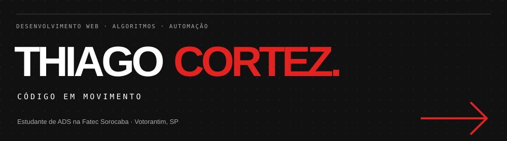
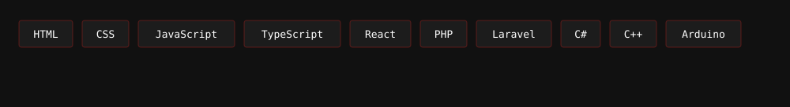
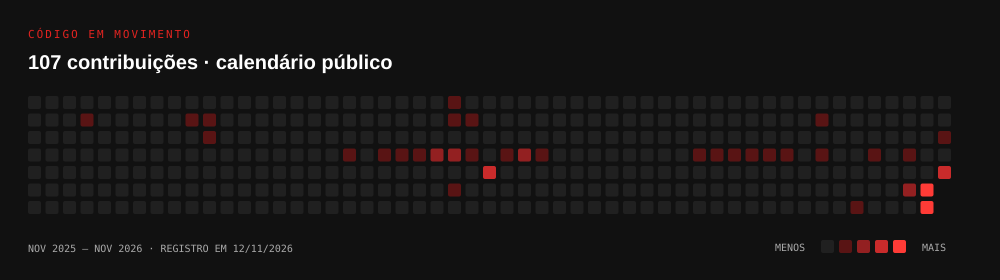

  
  
  

## Sobre mim

Sou **Thiago Cortez**, estudante de **Análise e Desenvolvimento de Sistemas na Fatec Sorocaba**, com formação técnica em Desenvolvimento de Sistemas.

Transformo o que estudo em projetos. Exploro interfaces web, estruturas de dados e automação com sensores, conectando a lógica do código a aplicações que posso testar e melhorar.

## Tecnologias nos meus projetos

## Projetos em destaque

| Projeto | O que desenvolvi | Explore |
| --- | --- | --- |
| **ArvoreLab** | Laboratório visual de árvores e estruturas de dados. | [Código](https://github.com/ThiagoCrtz/arvores-edu) · [Aplicação](https://arvores-edu.vercel.app/) |
| **HidroFlow** | Irrigação com Arduino e apresentação com maquete 3D interativa. | [Código](https://github.com/ThiagoCrtz/HidroFlow) · [Site](https://hidroflow.vercel.app/) |
| **Rende** | Simulador para comparar investimentos de renda fixa. | [Código](https://github.com/ThiagoCrtz/rende-calculadora) · [Aplicação](https://rende-calculadora.vercel.app/) |
| **Luvit** | Rede social para descobrir filmes e jogos e compartilhar avaliações. | [Código](https://github.com/ThiagoCrtz/luvit-tcc) |
| **O-Brechó** | Gestão de doações, triagem, peças, clientes e vendas da ANG. | [Código](https://github.com/ThiagoCrtz/o-brecho) |
| **Portfólio** | Experiência em preto, branco e vermelho com interações de ponteiro e clique. | [Código](https://github.com/ThiagoCrtz/portfolio) · [Site](https://thiago-cortez-galeria.vercel.app/) |

## Código em movimento

Calendário público de contribuições, registrado em **12/11/2026**.

## Formação

- **Análise e Desenvolvimento de Sistemas** — Fatec Sorocaba, 2026–2027 (previsão).
- **Técnico em Desenvolvimento de Sistemas** — concluído.
- **IT Essentials** — Cisco Networking Academy.

---

  <strong>Uma ideia, um projeto ou uma boa conversa sobre tecnologia.</strong> 
  <a href="https://thiago-cortez-galeria.vercel.app/">Explore meu portfólio</a> · <a href="mailto:thiagopcortez@gmail.com">Entre em contato</a>

